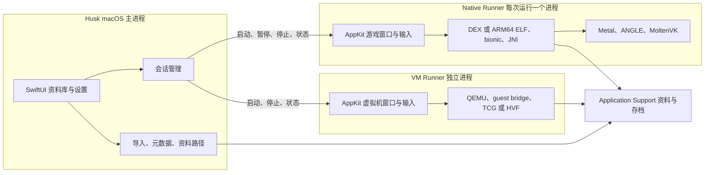

# Husk 原生 macOS 迁移计划

日期：2026-10-07；实施状态更新于 2026-10-08。状态：**P0 已完成；P1–P3 原生内部原型及本机后台验收已完成；P4 指定 Minecraft 样本的后台闭环已完成，其他引擎待样本；P5 基础实现及 Android 验证已推进，Minecraft VM 黑屏与持续音频仍阻塞验收；P6 未开始**。审计依据见[审计报告](/Users/tanmy/Projects/Husk-macOS/docs/2026-10-07-audit-Husk-report.md)，P0 结果见 [P0 报告](/Users/tanmy/Projects/Husk-macOS/docs/2026-10-07-macos-p0-report.md)，后续结果见 [P1–P3 报告](/Users/tanmy/Projects/Husk-macOS/docs/2026-10-08-macos-p1-p3-report.md) 、[P4 Minecraft 报告](/Users/tanmy/Projects/Husk-macOS/docs/2026-10-08-macos-p4-report.md) 与 [P5 VM 报告](/Users/tanmy/Projects/Husk-macOS/docs/2026-10-08-macos-p5-report.md)，用法见[原生构建指南](/Users/tanmy/Projects/Husk-macOS/docs/macos.md)。

P0 已选定新版 ELF loader 和双映射内存；同 Team ID Runner 候选仅带 unsigned-executable-memory。P1 的本地 ad-hoc Runner 为加载无 Team ID 的随附 ANGLE 另加 disable-library-validation，主 App 无 entitlement。当前 P0 默认测试为无窗口、无故障注入的后台入口，30 组通过；早先 39 组图形/故障验证另存为历史证据。可见测试曾影响用户桌面，今后需要显式选择，不自动循环启动窗口。

P1 的正式目标、依赖源码构建、打包/签名与 CI 定义均已完成，干净源码目录重建及本地检查通过；远程 CI 尚未执行。P2 资料库及 P3 首款 Orbit ELF 游戏已通过 31 项端到端检查和 20 次后台生命周期检查。手柄测试覆盖宿主输入路径，音频覆盖非零 PCM 与零增益 AudioQueue；实体设备、可听质量及完整前台交互仍需单独验收。下方里程碑保留原定门槛，不能把这些待验收项视为已通过。

已以 `82f33e858952f9fda3cf224e839f4385894e2d5b` 为起点建立 SwiftUI + AppKit 原生 macOS target，复用现有 C 运行时。第一可用版本打通资料库与自建翻译层游戏，后续补齐已有引擎及 QEMU 模式；完整迁移验收仍包含两种运行方式。

**规划假设与决策状态**

| 项目 | 建议 | 状态与理由 |
| --- | --- | --- |
| CPU | 首版 Apple Silicon arm64 | 待产品确认；Android arm64 指令与汇编桥接可直接复用，Intel 会新增 ISA 转译工作 |
| 系统下限 | 暂按 macOS 14+ 设计 | 待最低版本验证后锁定；本次只在 macOS 27 测试，不能声称已兼容 14 |
| UI 技术 | SwiftUI 场景/资料库 + AppKit 渲染与输入宿主 | 原生 macOS 方向；不采用 Catalyst 作为最终目标 |
| 窗口 | 资料库窗口与运行窗口分开；初期同时只运行一个 session | 避免一开始承诺多游戏并行，先完成正常切换及资源回收 |
| 发行 | Developer ID + Hardened Runtime + 公证的站外分发 | 推荐技术目标；证书、许可清单和发布渠道在发行阶段落实 |
| 隔离 | UI、Native Runner、VM Runner 分进程 | P3 独立 Native Runner 与 P5 独立 VMRunner 已接入；文件/网络沙箱仍需独立设计 |
| iOS | 保留原 target 与上游来源 | 共享代码按平台适配，macOS 构建不带 StikJIT/pairing/手机 entitlement |
| 兼容范围 | 按引擎和 APK hash 建矩阵 | 延续现有能力；不把任意 APK、32 位 ARM、x86 APK 或完整 ART 作为首版承诺 |

这些默认选择用于已授权的内部原型；最低系统、品牌/UI 定稿和公开发布仍需对应验收。

**建议的进程结构**

图中包含后续目标：Native Runner 已接入受信任 fixture ABI，以及指定 Minecraft 的 GameActivity/bionic/JNI 路径；其他翻译层引擎尚未完成；P5 VM 已冷启动完整 Android，但 Minecraft 与持续音频验收未通过。P3 已让 Runner 自己拥有 AppKit 游戏窗口，IPC 只传命令和状态。窗口布局/焦点等完整前台验收后再定型；只有产品明确需要主进程内嵌画面时，再增加 IOSurface/Metal 共享渲染方案。不能直接跨进程传 CAMetalLayer 指针。

独立进程可以回收全局引擎状态，但它本身不是安全沙箱。管理目录边界、导入内容权限和 guest 网络访问仍需独立设计。Native Runner 与 VM Runner 使用不同依赖集合，也便于重新梳理许可及签名组合。

**代码迁移边界**

| 现有代码 | 目标角色 | 具体工作 |
| --- | --- | --- |
| APK/ZIP/ELF/资源扫描、prefs/blit | SharedCore | 保持格式和行为，建立 macOS/宿主测试入口；扫描与可执行探测解耦 |
| `ApkMetadata`、`BundleUnpacker`、来源/manifest 模型 | SharedLibrary | 拆除 UI/日志单例依赖；平台路径和图标解码由 adapter 注入 |
| `TranslationLayerStore`、每游戏设置 | LibraryServices | 拆开 SwiftUI、UIImage 和业务持久化；统一导入、扫描、迁移与删除规则 |
| `husk-tl-xmem`、classic loader 的 JIT 接口 | DarwinRuntimeHost | 统一可执行内存契约；区分代码/数据、地址别名、W^X、缓存和线程行为 |
| ELF/bionic/JNI/各引擎驱动 | NativeRuntime | 保留核心实现，通过显式配置传资源路径、尺寸、输入、日志与停止接口 |
| `TLUnityView`/`TLScreenView`/Metal/GL 视图 | MacRenderHost | NSView/NSViewRepresentable、CAMetalLayer/MTKView、键鼠和文本输入 |
| `HuskAudio`、`HuskGamepads` | MacAudio/Input | 沿用音频数据和 GameController，替换 iOS 会话、通知、焦点语义 |
| `QemuRunner`/`HuskBridgeFS`/guest 管理 | VMRunner 与 HostServices | 保留机器与快照逻辑，拆出手机内存预算、全局 view 及 UI 状态 |
| `JITSetup*`/`JITPairing`/`JITBuiltIn`/StikJIT/Rust pairing | 仅留 iOS target | macOS target 不编译、不链接、不嵌入 |
| `project.yml`、依赖脚本、IPA 打包 | 平台独立构建入口 | 先固定依赖再生成工程；macOS 产物和 iOS sysroot 分目录 |

这些是职责划分，目录命名可在 P1 决定；不需要先进行大规模搬文件。先用独立 target/source list 建边界，再分步提取模块，保持与上游差异可审查。

**里程碑与验收门槛**

| 阶段 | 工作与产物 | 通过条件 | 依赖 |
| --- | --- | --- | --- |
| P0：已完成技术验证 | 固定基线；专用 macOS JIT/ELF fixture；权限矩阵；Runner 窗口/退出原型；依赖与许可清单 | ad-hoc Hardened Runtime 的生成代码、全局数据、TLS/x18 与四线程通过；故障/回收与历史 20 次启停有证据；当前默认后台 30 组通过。Developer ID/公证不在此结论内 | 当前审计 |
| P1：可复现构建 | 原生 HuskMac、NativeRunner target；SharedCore 编译；macOS ANGLE/MoltenVK；资源和 rpath；CI | 干净 checkout 可构建；产物无 iOS slice、个人路径、Steam/Homebrew 运行依赖；现有核心测试及签名自测在 CI 通过 | P0 |
| P2：原生资料库闭环 | 桌面导航/列表、导入/拖放、扫描、图标、游戏设置、持久化；系统菜单/设置窗口；Application Support 存储 | 导入、重启保留、删除与存档规则一致；损坏/不支持 bundle 有明确错误；UI 主进程不需要 JIT | P1 |
| P3：第一款游戏完整运行 | Native Runner 接入一款合法可用 fixture；画面、键鼠/手柄、音频、暂停/恢复、存档、错误回传 | 从导入到交互完成；关闭后可重新启动、换游戏；Runner 崩溃不杀主界面；存档跨正常退出保持 | P0–P2 |
| P4：已有引擎覆盖 | 依次验证 DEX、Unity、Cocos、SDL/NativeActivity、GameActivity、Unreal/Vulkan、Rockstar；每类固定样本和期望 | 每条宣称支持的路径有运行记录；窗口/缩放/输入/音频/恢复满足矩阵；失败路径明确记录，不能只凭首帧通过 | P3 |
| P5：VM 模式原生化 | 构建带所需 GPU 栈的 macOS QEMU；VMRunner；冷启动 guest、桥接、安装与启动 APK；TCG 基线及 HVF 探索 | Android 可冷启动且应用可交互；磁盘/网络/输入/音频通过；HVF 仅在实测通过后启用；snapshot 仅恢复匹配机器指纹 | P1、P2；可在 Native 路线稳定后单独推进 |
| P6：发行与回归 | 依赖 notices/源码链接、签名、公证、安装更新、最低系统/另一台干净 Mac、休眠与故障恢复 | 从下载到安装和启动可复现；无开发环境依赖；既有数据升级保留；所有公开支持能力有对应证据 | 目标发行范围内的 P4/P5 |

P4 本轮按用户指定的 Minecraft 1.26.52.3 APK 执行：真实世界输入、Unicode 文本、20 次 Activity 恢复、10 分钟世界运行、正常存档重开、隐藏原生 surface 与受控退出恢复均已通过。该结论限定到精确 APK hash 和报告中的本地测试边界；上表其余引擎仍需各自样本，不能把 Minecraft 结果外推为全部引擎完成。

P3 是内部可用原型，P4 可以形成翻译层预览版，P6 才是相应范围的发行验收。完整双模式迁移必须包含 P5；其排在后面不代表取消 VM 功能。P0 结束后再估工期，当前 JIT/alias 布局和 guest/HVF 风险不适合用 UI 工作量推算。

**P0 要先回答的工程问题**

1. 当前 `mach_vm_remap + mprotect` 默认路径在受限签名配置下已失败。验证受系统支持的 MAP_JIT 内存设计、线程写保护/回调策略，以及仅必要的 entitlement；把成功配置与限制写成决策记录。Apple 文档对 Hardened Runtime + allow-jit 的单 MAP_JIT region 限制也要进入设计。
2. 两条 loader 都要覆盖。先执行返回常量的代码，再用仓库自建 ARM64 ELF fixture 验证 RW 全局数据、重定位、4 KiB ELF/16 KiB host page、TLS、x18、多个线程和 JIT 区域耗尽；不能只用两条指令替代完整 loader 验收。
3. `husk-tl-ld` 的 PC-relative 改写依赖 RX/RW alias 距离和数据地址，故 allocator 不能只做 API 名称替换。明确可执行代码与可写数据的地址契约，并检查动态 stub 写入和 icache 同步。
4. Runner 使用 `starting → running ↔ paused → stopping → exited/failed` 状态；每次 launch 有独立 session ID。关闭时先请求正常停止并确认存档，超时才终止进程；旧 session 的回调不得覆盖新 session。
5. 原型验证 Runner 自有窗口的菜单/焦点/Dock/主 App 退出联动。发布签名路径最后必须使用 Developer ID 和公证再测；本轮 ad-hoc Hardened Runtime 实验不能替代它。

**桌面行为的最低验收**

| 项目 | 验收内容 |
| --- | --- |
| 窗口与画面 | 横竖游戏、全屏、窗口缩放、外接屏与倍率变化；先固定虚拟 Android 分辨率并等比显示，输入坐标按实际 viewport 反算；支持动态分辨率的引擎再单独开放 resize |
| 键鼠 | 左/右键、滚轮、拖动、按键抬起、焦点丢失；需要相对鼠标的游戏明确捕获和释放方式；不能把所有键盘输入伪装成手机滑动 |
| 文本 | AppKit 文本输入/IME、组合文字、删除、粘贴与取消；游戏输入不吞掉系统菜单快捷键 |
| 手柄 | 热插拔、焦点路由、暂停后清除粘滞按键、已有轴向与 trigger 映射；首版单 session |
| 音频 | 系统设备切换、静音、暂停、最小化策略、休眠唤醒；无持续爆音和失控音频线程 |
| 数据 | 主资料目录与缓存/日志分开；导入默认复制到受管资料库；重启/异常退出/磁盘不足不会覆盖现有存档；删除游戏与删除存档按明确规则执行 |
| 可靠性 | 连续启动/关闭至少 20 次无残留 Runner、文件锁或端口；代表游戏持续运行至少 30 分钟，记录帧率、内存趋势和实际交互结果 |
| 版本与 VM | guest、QEMU、accelerator、CPU、vCPU、RAM、图形设备都进入快照指纹；配置不匹配时说明原因并冷启动，避免盲目载入旧快照 |

界面布局以现有产品功能为基础，进入实现时先给出可审查的桌面方案。调试指标和技术报告保持在开发信息中，不作为普通用户完成导入和运行所必需的步骤。

**构建、测试与分发约束**

- ANGLE 固定 WebKit commit；MoltenVK 先维持 v1.4.2 基线并构建 macOS slice，再决定是否升级。QEMU/virgl/libepoxy 的版本和补丁保持成套，不能在移植过程中同时无记录地升级整个图形栈。
- 修复 main 宿主测试的 `tl_find_stikdebug_prewarmed` 依赖，给 variadic harness 明确日志 adapter；消除对 LLVM 文本格式的脆弱断言或固定工具版本。保留首次失败和修正后的测试证据。
- CI 分开 parser/core、macOS compile/link、Hardened Runtime JIT、依赖产物检查；真实 GUI/游戏/HVF/干净机器验收单列，不能用绿色构建替代。
- 删除 macOS 构建对 IPA、iOS pairing 和 guest 预打包脚本的隐含依赖。TL-only 构建不应因为 QEMU guest 缺失而失败；VM 资源走明确的获取与校验流程。
- 主 App 和每个 helper 的签名、资源、Frameworks/rpath 各自检查；测试从 Finder 启动的安装产物。先核对实际最小权限，再确定是否需要额外运行时例外。
- guest 来源及用户数据版本独立于上游 iOS 更新源。macOS 未验证的 iOS snapshot 不自动下载应用；镜像下载沿用摘要校验，并补全发行者自己的来源/许可记录。
- 公开发行前重审 QEMU、MoltenVK、ANGLE、guest kernel、证书包及 notices/源码提供。进程拆分不自动解决所有许可证问题。

P0–P5 的本地实现保留在 `codex/macos-p0`，尚未提交或推送。用户随后授权 P4 并指定 Minecraft，再要求继续推进 P5。P4 的指定样本已完成后台世界闭环；P5 原生 VM、Android 冷启动、安装、输入、网络、关机和持久化已有证据，但 Minecraft VM 黑屏/ANR 与持续音频仍阻塞整阶段验收。P6 尚未执行。
