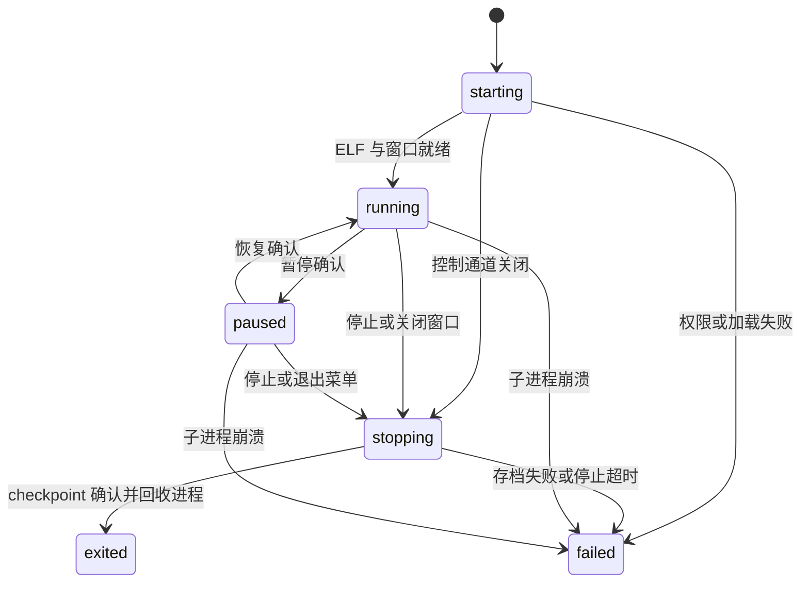

# Husk macOS P0 技术路线验证

日期：2026-10-07。实施分支：`codex/macos-p0`，基线：`82f33e858952f9fda3cf224e839f4385894e2d5b`。P0 采用 **新版 ELF loader + 双映射可执行内存 + 独立 AppKit Runner**。在本机 ad-hoc 签名、Hardened Runtime、无调试器条件下，这条路线已经通过合成执行和进程生命周期验证。

本阶段交付的是技术原型与可复现测试。正式 macOS 主 App、构建 target、游戏运行、Developer ID 签名和公证分别留在后续阶段。既有 `main` 未移动，审计报告与原始失败证据保留。

本轮曾反复启动并激活测试窗口，且主动 abort 用例留下系统崩溃提示，影响用户正常使用。用户指出后已停止可见测试。默认入口现为无窗口、无 AppKit 激活、无主动崩溃的后台模式；窗口、故障和压力次数均改为显式选择。此前 39 组结果保留为历史快照，不能用技术断言通过来淡化桌面干扰。

**可执行内存决策**

| 方案及权限 | 本机结果 | 决策 |
| --- | --- | --- |
| 双映射，开发态 | 生成代码、多线程执行通过 | 作为开发对照 |
| 双映射，Hardened Runtime，无额外 entitlement | SIGKILL；前序审计的同类失败确认为 CODESIGNING Invalid Page | 不可用于 Runner |
| 双映射，Hardened Runtime，仅 `allow-jit` | SIGKILL | 不能把 allow-jit 当作现有 allocator 的通行证 |
| 双映射，Hardened Runtime，仅 `allow-unsigned-executable-memory` | 256 次分配、四线程、生成指令、ELF、Runner 通过 | P0 选择 |
| 双映射，同时添加 unsigned-memory 与 allow-jit | 通过 | 当前方案没有添加第二项的必要 |
| 标准 MAP_JIT，仅 allow-jit | 开关线程写保护后，生成代码返回 42 | 证明标准 JIT 本身可用 |
| 标准 MAP_JIT，执行代码时向同一 JIT 区域的数据地址写入 | SIGBUS | 不能直接替换当前 ELF 双映射契约 |

选定的 [Runner entitlement](/Users/tanmy/Projects/Husk-macOS/src/macos-p0/NativeRunner.entitlements) 只有 `com.apple.security.cs.allow-unsigned-executable-memory=true`。代码仍通过 RW 地址写入，通过 RX 地址执行，并显式刷新指令缓存。两者距离保持固定且在 loader 的 ADRP 可达范围内。

这项 entitlement 放宽整个 Runner 的可执行内存限制；双别名也允许同一物理页同时具有可写和可执行的不同视图。P0 接受这一取舍以保留现有 loader 的地址模型。未来主界面不需要此权限，Native Runner 每次运行创建新进程。进程隔离用于生命周期和崩溃回收，不构成文件或网络安全沙箱。

Runner 用 Security.framework 在加载前读取自身 entitlement，缺失时报告 `failed` 并以 70 退出；负向测试确认其不会执行到导致 Invalid Page 的位置。没有加入 `get-task-allow`、`disable-library-validation`、pairing 或 iOS entitlement。

Apple 文档依据：[unsigned executable memory entitlement](https://developer.apple.com/documentation/bundleresources/entitlements/com.apple.security.cs.allow-unsigned-executable-memory)、[Apple Silicon JIT 移植](https://developer.apple.com/documentation/apple-silicon/porting-just-in-time-compilers-to-apple-silicon)。本轮已通过 Context7 查询当前文档，并以运行结果验证适用范围。文档描述的 MAP_JIT 区域/线程限制仍需遵守；classic 的第二次分配在本机成功，并不据此推断其他 macOS 版本的行为。

**P0 找到并修复的代码问题**

| 问题 | 影响与修复 | 验证 |
| --- | --- | --- |
| 新版 loader 用 16 KiB host page 的权限并集判断函数指针 | 4 KiB ELF 的构造函数与数据落在同一 host page 时，RELATIVE/RELR 指针错误指向 RW，调用构造函数 SIGBUS。现在优先按代码范围确定 RX | 三种 relocation fixture 都运行构造函数和代码指针 |
| ADR/ADRP（包括目标寄存器 x18）沿用 host page 粒度 | 代码附近的可写数据导致代码地址被重定向到 RW。ADR 按代码范围区分；ADRP 按 ARM64 的 4 KiB 指令页与 ELF 可写段交叠判断 | 显式汇编覆盖 ADR、ADRP、x18 返回的代码地址并执行 |
| classic 将代码/数据混合页整体 carve 为 RW | 去掉该页执行权限后仍调用构造函数，原先直接 SIGBUS。现在在 MAP_JIT 分配前明确拒绝 | 4 KiB fixture 返回可读错误；16 KiB fixture 与第二库继续通过 |
| allocator 对零长度、round-up 溢出和环境大小参数缺少检查 | 可能返回重复地址或错误大小。现在拒绝无效参数，失败不修改分配输出 | 零长度、SIZE_MAX、非法 `TL_XMEM_MIB`、耗尽与原有映射完整性 |
| 连续异常退出触发 AppKit 恢复窗口对话框 | 对话框在 didFinishLaunching 之前阻塞启动。一次性 Runner 窗口设为不恢复，并在进程内设置 `ApplePersistenceIgnoreState`，由监督器决定重启；不写全局 defaults | 保留原有崩溃历史后重跑，正常/故障重启和 20 次启停通过 |

相关改动位于 [新版 loader](/Users/tanmy/Projects/Husk-macOS/src/translation-layer-next/husk-tl-ld.c)、[allocator](/Users/tanmy/Projects/Husk-macOS/src/translation-layer-next/husk-tl-xmem.c)、[classic loader](/Users/tanmy/Projects/Husk-macOS/src/translation-layer/husk-tl-load.c)。这些属于共享运行时代码；三个文件的 iOS arm64/16.4 语法检查通过，iOS 设备运行尚未验证。

**两条 loader 的去向**

| 能力 | 新版 `husk-tl-ld` | classic ELF 核心 |
| --- | --- | --- |
| writable global、BSS、GOT、host import | 通过 | 16 KiB fixture 通过 |
| RELA / RELR / Android APS2 | 三类均运行通过 | 本轮运行覆盖 RELA，其余保留既有扫描/解析回归 |
| 4 KiB ELF / 16 KiB host 混合页 | 修复后通过 | 明确拒绝 MAP_JIT carve 布局 |
| 构造函数、ADR/ADRP 代码地址 | 通过 | 构造函数在 16 KiB fixture 通过 |
| TLSDESC、x18、四线程隔离 | 通过；每线程 1,000 次 guest 操作 | PT_TLS 明确拒绝；不宣称同等能力 |
| initial-exec TLS | 明确拒绝 | 不支持 |
| 可执行区域耗尽 | allocator 与真实 loader 均可控失败，已有代码仍有效 | 本轮未把 classic 扩展为共享 allocator |

macOS 的原生 ELF 默认走新版 loader。classic 保留原有代码与 DEX 入口，其 DEX 迁移在 P3/P4 使用独立验收，不能将本轮 ELF 核心测试当成 DEX 或 NativeActivity 完整运行证明。新版本轮 TLS 覆盖库内 TLSDESC；跨库未定义 TLS、其他 TLS 模型、所有 x18 指令形式与任意 ELF 布局均没有被全面认证。

**Runner 的可观察契约**

[NativeRunner.m](/Users/tanmy/Projects/Husk-macOS/src/macos-p0/NativeRunner.m) 负责 AppKit 窗口、菜单、guest tick 和 checkpoint；[session.py](/Users/tanmy/Projects/Husk-macOS/src/macos-p0/session.py) 是 P0 监督器，P1 将按同一契约接入原生主 App。



IPC 为专用 stdin/stdout 管道上的 JSON Lines，携带 protocol=1、UUID session、PID、单调递增 seq、state 与 ticks；stderr 单独留作日志。旧 session 事件在更新当前状态前丢弃，错误 session 命令被 Runner 拒绝。窗口属于 Runner，自身拥有菜单和焦点，不跨进程传递窗口或 CAMetalLayer 指针。

默认运行不创建 `NSApplication` 或 `NSWindow`，以 Foundation/CFRunLoop 驱动同一 guest tick、控制通道和 checkpoint。只有 `--show-window` 才创建并激活 AppKit 窗口。自动检查默认也走后台模式，可见窗口验收必须显式选择；本次调整后未再启动可见窗口。

正常停止先进入 `stopping`，停止合成 guest tick，然后写同目录临时 checkpoint、fsync、rename 和目录 fsync。Runner 发出 `checkpoint saved=true` 后再发 `exited`；监督器核对磁盘中的 session/ticks 并等待 OS 回收子进程，才承认正常退出。保存失败则返回 `failed`，没有成功保存确认。

停止超时默认 2 秒，然后向专用进程组发送 SIGTERM；0.5 秒后仍未退出则 SIGKILL，并等待回收。独立于 AppKit 主线程的 watchdog 在父进程消失后给正常停止约 2 秒，主线程挂起时也会结束 Runner。强制结束不能伪装为已存档。

启动事件在进入 AppKit 之前发出。P0 运行期间曾通过对受控进程采样及原生 UI 观察，确认启动超时来自系统的“上次重新打开窗口时意外退出”恢复提示；`build/macos-p0/startup-timeout.sample.txt` 保留诊断。修正后不删除系统恢复数据，也不依靠人工点击提示完成测试。Runner 使用仅本进程生效的恢复策略，同时禁用登录后自动重新启动，避免绕过会话管理。

自动测试覆盖菜单暂停、pause ack 后计数稳定、恢复、窗口关闭、菜单退出、旧 session、异常崩溃、再次启动、保存失败、TERM 被忽略后的 KILL、正常/挂起状态下父进程死亡，以及 20 次启动/停止。每次都使用新的 UUID/进程，并检查结束后的 PID 不再存活。

另用原生 UI 自动化实际观察了窗口与菜单，按 Command-P 暂停到 2,115 ticks、恢复后计数继续，再点击 Quit。会话 `c29310be-e00b-4f32-a5a4-0fa62da1f270` 的事件确认 `menu-quit → checkpoint → exited`，OS exit=0。此处是原生 AppKit 窗口实测；窗口中的计数器不是游戏画面，也没有完成 Dock 产品交互设计或真实输入系统验收。

**复现与证据**

从仓库根目录执行：

```sh
./scripts/test_macos_p0.sh
```

前提、工具覆盖参数、suite 选择及手动窗口命令见 [测试说明](/Users/tanmy/Projects/Husk-macOS/tests/macos-p0/README.md)。脚本不获取依赖或 APK，生成并签名本机测试产物。Apple Silicon、macOS 27.0 / 26A428、Xcode 27.0 / 27A266a 是本轮实测环境。二进制声明最低 macOS 14.0，仅表示编译目标，不构成 14.0 的运行证据。

最新默认后台运行保存在 [results.json](/Users/tanmy/Projects/Husk-macOS/build/macos-p0/results.json)，由同目录 `test-selection.json` 标识范围。修改前的完整 39 组交互/故障结果、环境和源码摘要已另存为 `interactive-results.json`、`interactive-environment.json`、`interactive-source-manifest.json`。图形与故障证据来自此前版本；新增后台入口已另行运行验证，没有重跑可见测试。

最终默认运行 **30/30 组通过**：内存/ELF/classic 17 组、后台 Runner 5 组、core 与 iOS 语法 8 组。其中 scanner 仍包含 41 项断言，planner 9 项；组数不是所有底层断言的数量。可保存在版本控制中的摘要见 [P0 结果快照](/Users/tanmy/Projects/Husk-macOS/docs/2026-10-07-macos-p0-results.json)。

每次构建的工具、命令、source SHA-256、fixture SHA-256 与页布局分别存放在 environment、commands、source-manifest 和 fixtures JSON。每次会话独立保存 events、checkpoint 和进程 result，原型动态依赖由 `otool -L` 检查，签名由 `codesign --verify --strict` 和实际 runtime flag 检查。

系统报告 `NativeRunner-2026-10-07-225042.ips` 的 PID 57384 与故障注入用例的 crashed_pid 相同，调用链为 `P0Delegate command: → abort → SIGABRT`；摘要保存为 `intentional-crash-evidence.json`。这些是实际被触发的崩溃，不是无关提示。电脑控制工具拒绝访问系统通知程序，因而无法自动点掉剩余的崩溃提示；测试进程已回收，没有终止系统报告服务或更改系统崩溃报告设置。

既有回归纳入统一入口：page planner、prefs、CoreGraphics 对照 blit、AAPCS64 variadic，以及带 ASan/UBSan 的 scanner。scanner 与 variadic 使用显式的宿主 adapter，原始 iOS runtime 没有为测试伪造能力。scanner 的 lld/readelf/objdump 固定为同一已安装工具目录；LLVM 文本格式差异仍在测试说明中列明。

最初 fixture 编译遇到的 outline atomics helper、构造函数被优化掉、缺少 CoreGraphics 链接等均属测试构建问题，已通过显式编译选项、volatile fixture 和 source list 解决。它们与真实混合页故障分开处理。

**依赖与许可清单**

| 组件 | 版本/来源证据 | P0 状态与许可处理 |
| --- | --- | --- |
| Husk runtime、Runner、fixture | 基线 `82f33e8` + 本分支；根 LICENSE / 源码 SPDX | 新源码沿用 GPL-2.0-or-later；P0 唯一随原型编译的项目源码 |
| AppKit / Foundation / Security / libSystem / libobjc | Xcode SDK；实际链接清单 `runner-dependencies.txt` | 使用 macOS 系统 framework/dylib，不复制 SDK 或系统库 |
| zlib | 系统 `/usr/lib/libz.1.dylib` | 用于 APK ZIP，动态链接系统实现；没有 vendor 副本 |
| clang / lld / readelf / objdump | environment.json 记录 Apple 21、upstream 23.1.2、NDK 17.0.2 | 构建/测试工具，不嵌入 Runner；LLVM 自身 notices 属工具发行方 |
| Python | 当前 3.14.8；监督器/测试源码无第三方 Python 依赖 | P0 开发工具，正式主 App 将使用原生监督器 |
| ANGLE | `build_angle_ios.sh` 当前拉取 WebKit 默认分支，未 pin | P0 不构建/链接；P1 必须锁定 commit 并核验 ANGLE 和内含第三方 notices |
| MoltenVK | `v1.4.2`；前序审计核对官方 LICENSE 为 Apache-2.0 | P0 不构建/链接；P1 构建 macOS slice，P6 审核实际组合 |
| QEMU | `utmapp/qemu v10.0.12-utm`；前序审计核对整体 GPLv2 | P0 不构建/链接；P5 VM Runner 使用独立依赖集合，发行时提供对应源码 |
| VM 基础库 | libffi 3.5.0、libiconv 1.16、gettext 0.22.5、GLib 2.83.0、pixman 0.38.0、slirp 4.9.1；见 sources.sh | P0 没有下载这些源码；P5 按实际构建范围逐项确认 LICENSE、patch、源码获取与 notices |
| libucontext / epoxy / virgl | `9b1d8f01a6e99166f9808c79966abe10786de8b6` / `bf98587477fe68d07b93319ece7b40a7d0e2eabe` / `482f9d8b8c2d2288efa10a027116216909d2c226` | 现有脚本 pin；P0 不构建，macOS 是否需要及具体许可文本在 P5 核对 |
| StikJIT / idevice / rppairing | 现有 iOS legal 资源与 Cargo.lock | P0 原型不编译/链接/嵌入；保留原 iOS 来源与 notices |
| Android guest、kernel、系统包 | 后续 guest 获取/构建产物 | P0 不下载/发布；P5/P6 按最终镜像确认来源、摘要、许可与对应源码 |

旧 [licensing 文档](/Users/tanmy/Projects/Husk-macOS/docs/01-licensing.md) 是 iOS 阶段的决策记录，不能直接当成 macOS 组合的发行结论。尤其 QEMU 整体 GPLv2 与 MoltenVK Apache-2.0 的组合必须按实际链接/分发结构审查；进程拆分本身不自动解决所有许可问题。

**P1 的入口**

P0 已证明可继续建立原生 macOS 构建。P1 应先增加 HuskMac/NativeRunner 正式 target，把监督器的 session/退出契约接入原生主 App；固定 ANGLE/MoltenVK 的 macOS 构建与签名路径，保持 UI target 不携带执行 guest 所需的 entitlement，并把 P0 入口纳入 CI。

后续验收仍要覆盖完整 bionic/JNI、游戏引擎退出/存档 adapter、音频与输入、DEX、VM/HVF、实际游戏持续运行、最低 macOS/干净 Mac、Developer ID 和公证。P0 的 ad-hoc Hardened Runtime 成功只解决本阶段的技术可行性，不代表这些项目已完成。
