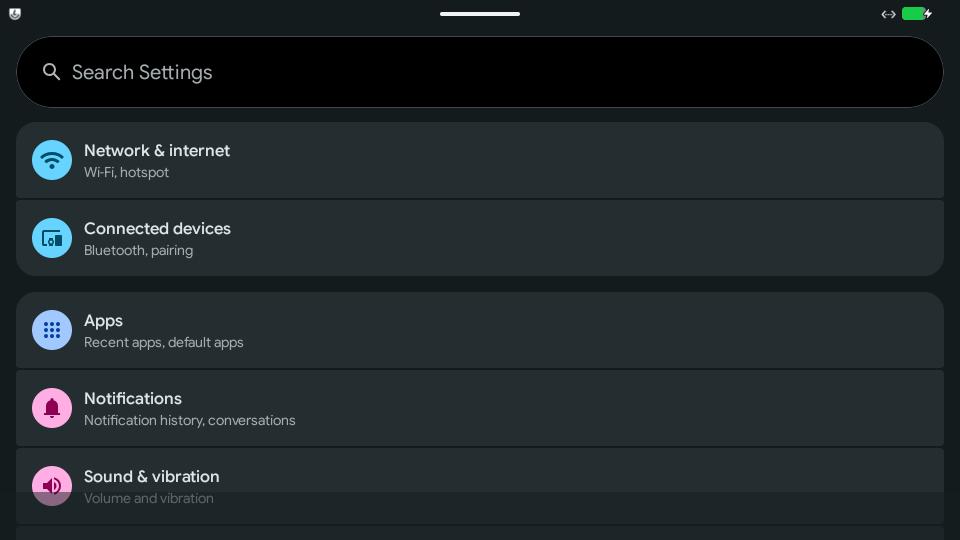
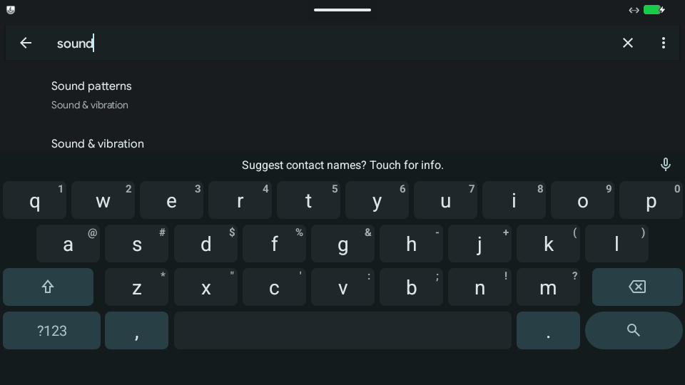

# P5：原生 VM 模式实施与验收

日期：2026-10-08。分支 `codex/macos-p0`，基线 `82f33e8`。P0–P5 修改仍在工作区，未提交或推送。

**P5 的原生 VM 基础设施已实现，整阶段验收未通过。** Android 在 TCG、HVF 两种模式下均能冷启动、显示原生 Metal 画面、响应输入、访问 HTTPS、安装指定 Minecraft，并在关机重开后保留磁盘数据。但 Minecraft 在 VM 中仍黑屏，持续音频也未通过。P4 翻译层中已经完成的 Minecraft 世界验收不能替代 VM 模式验收。

候选位于 `build/macos-p5-native/Product/HuskMac.app`。此次验证使用 macOS 27.0（26A428）、Mac13,2、128 GiB 内存。**当前 VM helper 的依赖要求 macOS 27**；主 App 和 NativeRunner 的部署参数仍为 14.0。旧系统和另一台 Mac 均未验证。

## 已实现的路径

| 环节 | 实现与边界 |
| --- | --- |
| 构建 | `HUSK_BUILD_VM=ON` 增加 VMRunner；默认 TL-only 构建无需 QEMU 和 guest |
| 进程隔离 | SwiftUI 主进程通过 `VMController` 启动独立 VMRunner；主 App entitlement 为空 |
| 执行与显示 | 固定 QEMU 10.0.12-utm、epoxy、virgl；复用固定 ANGLE；AppKit 窗口、CAMetalLayer 和 Metal 呈现 |
| 输入与音频 | USB keyboard/tablet 事件、失焦释放、真实 AudioQueue；本轮所有队列增益为零 |
| 控制 | 具备会话 UUID、PID、连续序号的 JSON 协议；QMP 状态、暂停、继续、关机；父进程监视及有界关闭 |
| 安装 | 单 APK；读取 manifest package；宿主和 guest 两侧校验 SHA-256，再调用 Android package manager |
| guest | 脚本下载、校验、复制独立磁盘；排他运行锁；从磁盘冷启动；不导入 iOS 内存快照 |
| 指纹 | 记录 guest、固件、实际 QEMU/ANGLE 哈希、CPU、accelerator、vCPU、RAM、图形、音频和分辨率 |
| 快照 | 显式拒绝保存与恢复内存快照；virgl 和 virtio-sound 的迁移限制没有被绕过 |
| 应用入口 | Android 菜单、选择已准备的数据目录、安装并启动所选 APK；当前默认 TCG + virgl |

核心入口为 [VMRunner](../src/macos/VMRunner/main.m)、[VMController](../src/macos/SharedLibrary/VMController.swift)、[依赖构建](../scripts/build_macos_vm.py)、[guest 准备](../scripts/prepare_macos_guest.py) 和 [打包器](../scripts/package_macos_vm.py)。

## 真实运行证据

| 验收项 | 结果 | 证据 |
| --- | --- | --- |
| TCG + virgl，空白 userdata 冷启动 | 通过 | `session-tcg03`：Android `sys.boot_completed=1`、zygote/SurfaceFlinger running |
| HVF + virgl，空白 userdata 冷启动 | 通过 | `session-hvf01`：Android ready、LineageOS Welcome 的真实 Metal scanout |
| 网络 | 通过本轮范围 | 两种模式分别执行 HTTPS 请求，返回 200；桥接监听仅绑定 loopback。未把异常 ping 输出算作通过 |
| Minecraft 传输与安装 | 通过 | 两种模式均核对宿主/guest APK hash，`pm install` 返回 Success |
| 鼠标/触控 | 通过基础输入 | native tablet 输入操作 Minecraft 通知权限界面；Settings 搜索框点击 |
| 键盘 | 通过基础输入 | native USB key 事件在 Android Settings 输入 `sound`；截图与 UI hierarchy 均回读相同文字 |
| 暂停/继续 | 通过 | QMP 返回 paused/running；暂停状态可正常关机 |
| 正式 Swift 控制器 | 通过已记录路径 | 实际 helper 启动、ready、请求返回、正常关机、OS PID 消失、同一控制器重开 |
| 磁盘持久化 | 通过本轮范围 | 重开后 Minecraft 安装仍存在；HVF/TCG 各自 marker 保留；HVF 另一次关机重开保留 controller marker |
| 短促 PCM 到 AudioQueue | 通过 | 收到非零 guest PCM，静音真实设备回调持续运行 |
| 持续播放/游戏音频 | **未通过** | Android 报告音频活跃，但宿主 guest PCM 计数停止；Clock timer 未形成持续传输证据 |
| Minecraft 主菜单/世界 | **未通过** | 两种模式均黑屏；guest screencap 也黑，不能归为单纯宿主截屏问题 |

运行目录统一在 `build/macos-p5/`。`session-hvf01`、`session-tcg03` 是初版运行；`controller-hvf01`、`controller-tcg01` 是通过产品 Swift 控制器执行的后续验收。结果 JSON 记录具体进程、终态、配置及产物哈希。

## 已修复的问题与保留的失败

初版冷启动因 virtio-net 默认寻找未打包的 `efi-virtio.rom` 而正常报错退出。此 VM 从磁盘启动，已通过 `romfile=` 关闭网卡 PXE ROM。

桥接状态帧可能被 TCP 拆分；原先检测到 token 就解析退出码会误读。现在等待完整换行并严格解析状态。超时关闭连接，不自动重放可能已经生效的安装、关机等命令。真实 socket 回归覆盖分段帧与超时。

首次 HVF/TCG guest 均能完成关机和 `qemu_cleanup`，但宿主换到 AppKit 主线程 `exit()` 时，QEMU 的退出通知等待另一线程持有的 BQL，进程挂起。`sample` 已留存准确调用链。旧的两个挂起进程在磁盘清理完成后被回收，实际进程结果是 **-9，不计干净退出**。修复采用 QEMU 正确的返回值/API 声明，在清理后释放 BQL/replay 锁，并在 QEMU 线程退出；后续正式控制器验收确认进程正常消失。

`VMController` 的 shutdown task 原先在结束后仍非空，下一次会话会跳过关机。已在启动和终止时取消、清空任务，并通过同一对象重开及再次关闭验证。打包阶段还移除了 CMake 的绝对 build rpath，避免依赖开发目录。

依赖构建脚本现在在首次 clone 后检出固定 commit；已有错误 checkout 会保留文件并报错。导出符号插入改为幂等，修复重复构建导致的重复声明。许可证文件随验证后的依赖前缀进入产物，独立源码重建不再静默漏掉 QEMU/epoxy/virgl notices。

TCG + software 路径曾无法稳定启动 SurfaceFlinger/桥接，关闭超时后受控退出 75。这一图形配置没有通过当前 guest 验收；实际默认使用 virgl。

## Minecraft 阻塞的证据边界

测试样本是用户提供的原始文件，未修改或重打包：

- 路径：`/Users/tanmy/Downloads/minecraft-1.26.52.3-arm64-v8a.apk`
- 包名：`com.mojang.minecraftpe`
- 版本：`1.26.52.3`，versionCode `982605203`
- 大小：`1,048,027,974` 字节
- SHA-256：`83468d0acede2cabe3645ff4025a9c190be3cfb90e1864bcbe0277e97967cd95`

游戏能够加载 `libminecraftpe.so`、注册 GameActivity、进入 native 初始化、取得图形 context；日志有 `MinecraftGame::init && MinecraftGame::setSize!` 和 `LICENSED` 回调。通知权限允许/拒绝两条路径、TCG/HVF 两种 CPU 执行方式都未消除黑屏。没有修改 APK、模拟登录或绕过许可。

初次会话未出现 Minecraft crash/ANR；后续关锁屏/恢复操作触发了实际 guest ANR：`Input dispatching timed out ... FocusEvent(hasFocus=true)`。Android 提供的栈显示 UI 主线程在 `GameActivity.onSaveInstanceStateNative` 中经 `pthread_cond_wait` 等待。此栈证明生命周期等待卡住，并未确定导致游戏线程停滞的根因。保存到 `controller-hvf01/anr-13.txt` 和相关线程栈文件。

guest 显示 `Mesa virgl / OpenGL ES 3.0`，使用 AIDL audio HAL。根据 AOSP 文档试验了 `aaudio.mmap_policy=1` 并正常重启 guest audioserver，但游戏仍建立 MMAP stream、仍黑屏，不能把该设置视为已生效的修复。诊断设置在本轮测试后撤回并冷启动。当前需要进一步区分 guest 音频 HAL、游戏初始化和渲染同步问题。

## 构建、签名与回归

367 个非 ignored 文件导出到独立源码目录，复用已校验的图形/VM 依赖前缀，完成 VM-enabled 重建和 10/10 CTest；297 个实现/构建/测试文件与当前工作区逐文件 hash 一致。另一份 TL-only 构建通过 9/9 CTest。该证据是本机独立源码目录重建，不是另一台干净 Mac 或全新依赖下载验收。

全部 VM 验收进程已退出。关机后对 HVF/TCG 各自的 system、userdata、UEFI vars 共六个 qcow2 文件执行检查，均未发现错误；原始 Minecraft APK 再次校验 SHA-256 一致。

验证器检查 macOS arm64、部署版本、Hardened Runtime、嵌套签名、entitlement 分离、rpath 及动态依赖闭包。VM helper 包含其依赖，不要求运行时存在 Homebrew 路径。由于本机 GLib/slirp 等依赖的最低版本，VM helper 和产品启动检查暂要求 macOS 27。主 App 不获得 hypervisor/JIT 权限。

P4 产品保留在 `build/macos/Product/HuskMac.app`，原 NativeRunner 与新候选中 NativeRunner 的 SHA-256 均为 `ff984b5d1dae1c772150ca1bc128ace76e24258743be0ff976fa20becc942ca9`。

所有本轮真实 VM 均采用不显示、不激活的 AppKit 窗口和零增益 AudioQueue；没有操作旧系统崩溃提示，也没有触碰原 Husk UI。没有新增匹配 Husk/NativeRunner/VMRunner 的 macOS DiagnosticReports 记录。guest ANR 与宿主进程退出挂起已分别记录，没有被当作成功。

## 后续门槛

P5 仍需要解决指定 Minecraft 在 guest 内的黑屏/生命周期等待，以及持续 PCM 传输。guest 首次启动仍显示 LineageOS 设置流程；测试用 provisioning flags 不等于已完成产品首次启动体验。完整前台窗口/全屏/缩放、实体输入设备和可听音质也没有在本轮验收。

内存快照暂时禁用是产品策略；恢复支持必须先具备可迁移设备和匹配指纹检查。HVF 有明确冷启动、交互、关机证据，但仍作为实验选项，未替换默认 TCG。P6 的 Developer ID、公证、完整依赖许可证/源码分发、旧系统及另一台机器验收未执行。

复现命令及数据目录说明见 [macOS 构建指南](macos.md)。机器可读快照见 [P5 results](2026-10-08-macos-p5-results.json)。
