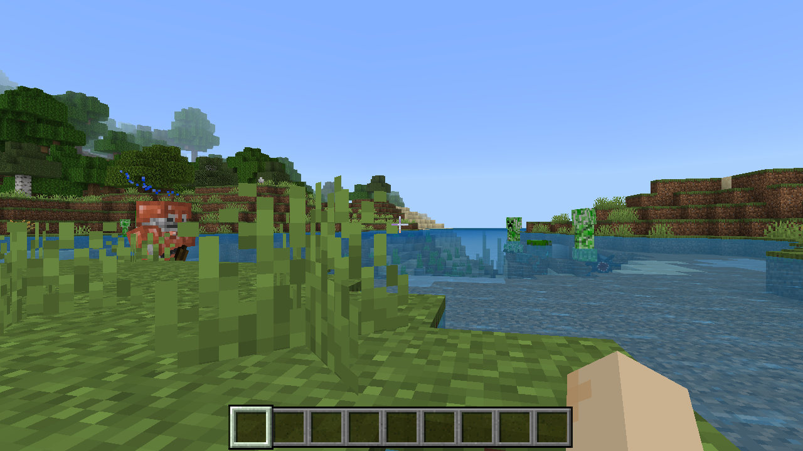

# macOS GUI 与上游同步记录

日期：2026-10-08。候选：Husk 0.2.0（build 2），`build/macos-upstream-20261008/Product/HuskMac.app`。

用户资料库中已经导入的 Minecraft 现在可以从 GUI 试运行，无需删除或重新导入。该 APK 已在本机通过实际世界加载、键盘移动、两次暂停/恢复、60 秒世界运行和正常保存退出。此结论针对原生运行路径；P5 的 Android VM 黑屏与持续音频问题仍未解决。

## 原因与修正

截图时运行的是 P3 阶段启动的旧进程 PID 15359。日常资料库的 Minecraft 也保存着当时的“仅支持 Orbit”原因，原来的读取逻辑不会随运行组件升级重新判断。另一个独立限制是完整 APK hash 白名单：用户导入的 `minecraft-mod_menu_1.26.52.3-mcpelife.apk` 与 P4 指定样本不同，主原生库也有差异，不能将它们视作同一个测试样本。

本次改为根据当前运行组件计算能力，读取旧 schema 1 索引时忽略过期的 `unavailableReason`。识别为 Minecraft 的 arm64 单 APK 可以试运行，完整验证过的 P4 样本仍单独标示。未接入的引擎与 Minecraft 分包不会显示为可运行。

执行前仍有两道完整性检查：资料库核对导入时的完整 APK hash，Runner 再独立核对 hash 并复扫引擎、manifest 与 ABI。放开实验版本不意味着信任可编辑索引中的引擎声明。新增回归覆盖旧记录升级、重复导入、设置及存档不变、实验标示、伪造引擎拒绝和文件变化拒绝。

Minecraft 详情页已使用对应的键鼠、文字输入和保存说明，不再显示 Orbit 的收集星星与重新开局操作。界面版本升到 0.2.0；未完整验证的版本显示“可试运行”和“试运行游戏”。

## 上游来源

| 项目 | 本次核对结果 |
| --- | --- |
| 仓库 | `https://github.com/Leviidev/Husk` |
| 原基线 | `82f33e858952f9fda3cf224e839f4385894e2d5b` |
| main 同步点 | `75dc21f82c1fd748867ad4d4b5dfb0e981c2d468` |
| 新增提交 / 路径变化 | 27 / 117 |
| topic 分支 | `claude/epic-hypatia-2hsqfv` 仍为 `756c8d0c9d81ffcf7e282cac98a69af1ff299522` |

完整源码变化已三方整合到工作区。117 个变化路径中，8 个文件需要保留本地差异，其余与上游一致（包括一项删除）。保留了 macOS 的可执行内存、loader 重定位、后台帧节流、AAudio 恢复、原生文字输入及独立进程生命周期修复。原始三方输入、冲突决议和源码 SHA-256 清单在 `build/upstream-sync-20261008/`；来源锁在 [dependencies/upstream.lock.json](../dependencies/upstream.lock.json)。

与本任务有关的更新包括：

- Minecraft 的 GameTextInput 与 IME 动作；同时转发上游 iOS 键盘和 macOS 原生输入。macOS 保留此前验证过的完整 UTF-8、字素及组合输入处理。
- 音频低采样率处理、FMOD Java 音频接口、APK 内 `jar:file:` 文件访问。
- 递归 loader 锁、`RTLD_NOLOAD`、外部原生库、C++ 异常运行库选择、DNS 与 Google Play services 兼容接口。macOS 构建补齐对应源文件与 resolver 链接。
- 分包名称排序、上游 Godot/Geode 支持及 Mac 回归工具源码。

Godot、Geode、Unity、iOS Store 等源码已同步，但其 macOS GUI 入口和样本验收并未因此自动完成。新提交没有直接涉及本次 P5 所用的 QEMU 或 guest 镜像，不能据此宣称 VM 黑屏修好。工作区仍保留 P0–P5 未提交修改，Git HEAD 未前移，也没有提交或推送。

## 验证

在全新的 `build/macos-upstream-20261008` 构建目录完成编译，复用已校验的固定图形和 VM 依赖缓存。11/11 CTest、P0 后台 30/30、4 个合并 C 文件的 iOS 条件语法检查、嵌套签名及依赖闭包检查通过。该结果不是全新机器、旧版 macOS、iOS 实机或发行签名验收。

| 样本 | SHA-256 | 本次范围 |
| --- | --- | --- |
| 用户实际导入的 Minecraft | `bceb3203f3b8897ee498bb3f22bd2373ac9b411a37cd4968a62f942c35d0c37e` | 菜单、既有世界、W 键移动、两次 Activity 恢复、世界持续渲染/PCM、正常保存退出 |
| P4 指定 APK | `83468d0acede2cabe3645ff4025a9c190be3cfb90e1864bcbe0277e97967cd95` | 更新后菜单、世界加载及正常退出回归；原完整验收仍见 P4 报告 |

用户 APK 的世界采样为 **60.125 秒 / 3,597 帧 / 59.825 fps**，RSS **1,791.06–1,792.88 MiB**。每次宿主恢复后先手动发送游戏的 Resume Game 输入并核对实际世界画面，再统计世界采样，未把暂停菜单当作世界运行。音频通过真实 AudioQueue、增益为 0；记录到持续非零 PCM，不是听感验收。

测试从日常资料库复制了一份独立副本，再复制既有 P4 测试世界；没有把测试世界写入日常资料库。原始下载 APK、用户导入副本、日常设置和资料索引保持原样。此 mod 版本的附加菜单/附加组件、账号、联机、商城与完整 P4 矩阵未验证，GUI 因此仍显示“可试运行”。

实际用户 APK 的世界画面：

## GUI 交付与剩余边界

新候选的正式 SessionController 已用于上述真实游戏测试。主界面的启动条件与资料库升级逻辑经过独立回归。CUA 原生通道返回 `Sky Computer Use native pipe closed before response`，重置连接后仍未恢复，因此本次没有新增 GUI 的可访问性树或截图验收。

最终检查时旧 UI 已退出，本轮没有向它发送终止信号。随后只通过 CUA 后台启动一次新候选，进程路径确认指向 0.2.0，PID 13772；CUA 的截图/AX 请求仍报原生通道断开。最终进程和资料核对记录在同名 results JSON。P4/P5 的旧产物和历史报告保留，不覆盖为本次结果。P5 仍为未通过，P6 尚未开始。

原始日志：`build/upstream-sync-20261008/ctest-final.log`、`p0.log`、`ios-syntax.json`、`bundle-final.json`、`session-imported01/`、`session-baseline01/`。可携带摘要见 [结果快照](2026-10-08-upstream-sync-results.json)。
